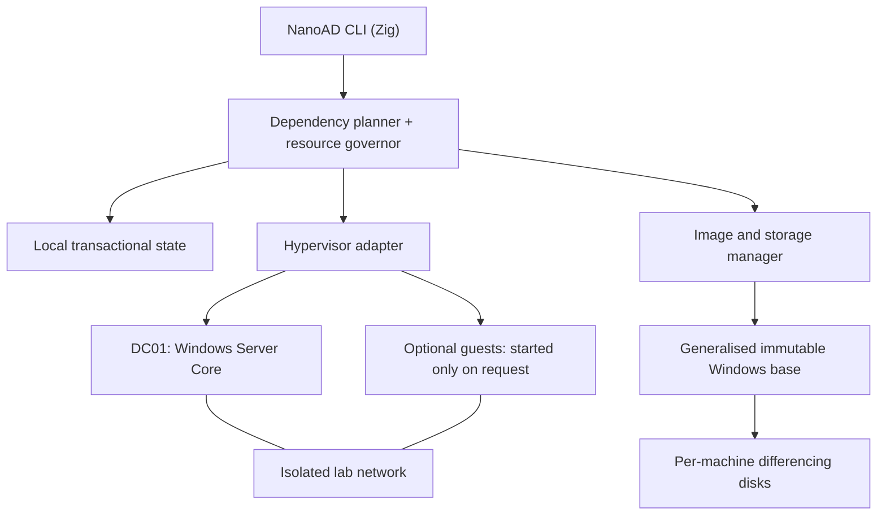

# NanoAD

**Real Active Directory. Every byte counts.**

NanoAD is an experimental, resource-aware Microsoft Active Directory lab orchestrator written in Zig. Its aim is to make genuine Windows AD environments accessible on low-specification hardware, without substituting a simulated directory service.

Rather than running an entire vulnerable infrastructure continuously, NanoAD is designed to provision only the machines, roles, directory objects and tools needed for the current exercise. Optional components remain absent or stopped until explicitly requested.

> **Project status:** experimental implementation and feasibility research. The Zig CLI supports `version`, `doctor`, `modules list` and `modules info <id>`; module discovery is metadata-only. No working lab release, validated Windows image or measured AD resource savings are available yet.

## Design principles

- **Native fidelity:** actual Windows Server Core and Microsoft AD DS, DNS, LDAP, Kerberos, NTLM and Windows security semantics. No protocol emulation as a replacement for Windows.
- **Demand-driven:** no optional module is installed, downloaded or started without an explicit request and a visible dependency plan.
- **Budget-first:** enforce memory and physical storage budgets; offer safe alternatives before refusing an operation.
- **Minimal footprint:** shared immutable base images, sparse differencing disks, measured service overhead and bounded memory allocations.
- **Reproducible:** versioned image recipes, deterministic fixtures, explicit lifecycle transitions and repeatable health checks.
- **Safe by default:** isolated networks, synthetic identities, no production integration, no persistent NanoAD daemon outside a session.

## Initial targets

| Metric | Target (not measured) |
| --- | --- |
| Reference host | x86-64, 8 GiB RAM |
| Minimal lab, installed footprint | At most 24 GB (24,000,000,000 bytes) physically allocated |
| Domain controller guest memory | Establish a supported baseline; investigate 1–2 GiB where feasible |
| Optional active workloads | None by default |
| NanoAD processes after shutdown | Zero |
| CLI binary, simple-command RSS | At most 2 MiB / 5 MiB, stretch targets |
| Session supervisor RSS | At most 10 MiB, stretch target |

Installation media, temporary build space, host OS requirements and hypervisor installation are reported separately; peak total usage must also be measured. A 32 GB or larger virtual system disk may occupy less physical storage when thin-provisioned. No target is a claim of current performance.

## Architecture



The first reference provider is VirtualBox on Windows x86-64. KVM/QEMU on Linux is planned after the reference implementation; Hyper-V is a subsequent candidate. Packer is optional build-time tooling, not a runtime dependency. PowerShell is used for Windows-native provisioning. No required Docker, Vagrant, Node.js, database server or web UI.

## Intended workflow

The following illustrates the intended end-to-end CLI. Only the read-only commands above are implemented; VM and module mutations are not available.

```sh
nanoad doctor
nanoad init
nanoad image build --media /path/to/official.iso
nanoad up
nanoad status
nanoad modules list
nanoad enable member-server --dry-run
nanoad enable member-server
nanoad enable adcs
nanoad disable member-server
nanoad health
nanoad down
```

When activation would exceed a budget, NanoAD must explain the measured or estimated cost and offer eligible modules to stop, individually or together. It must never silently disable a pinned dependency, raise a strict budget, delete retained state or start an optional service.

## Documentation

- [System specification](specs/001-nanoad.md)
- [Resource optimisation and benchmark protocol](specs/002-resource-research.md)
- [Module lifecycle and CLI contract](specs/003-module-lifecycle.md)
- [Implementation plan](docs/IMPLEMENTATION.md)
- [Engineering tickets](tickets/001-nanoad/README.md)
- [Contribution and validation rules](CONTRIBUTING.md)
- [Security policy](SECURITY.md)

## Scope and responsible use

NanoAD is for education, authorised security research and defensive validation in disposable, isolated laboratories. It is not a production domain controller deployment system or a tool for connecting to third-party domains. Windows installation media and licences must be obtained lawfully by the operator. No proprietary Windows images or licence keys are distributed by this project.

## Licence

NanoAD source code is licensed under the [MIT Licence](LICENSE). Third-party software and Windows retain their respective licences.
