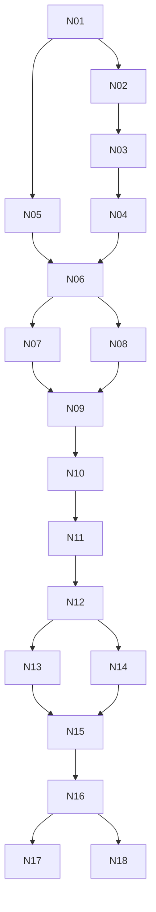

# NanoAD implementation plan

Status: proposed; all gates are pending. Parent specifications: [system](../specs/001-nanoad.md), [research](../specs/002-resource-research.md), [modules](../specs/003-module-lifecycle.md).

## Delivery strategy

First prove that genuine AD can meet the resource envelope; do not spend months building an orchestrator before checking the operating system constraint. Build a thin provider adapter and benchmark harness around that proof. Expand only once the core is qualified. Each ticket produces a testable vertical outcome; no implementation is represented as completed today.

| Milestone | Tickets | Deliverable / exit gate |
| --- | --- | --- |
| M0 — Feasibility | N01–N04 | Official Core image, genuine DC, reference fidelity, measured lower bound; stop if authenticity or host constraints fail |
| M1 — Minimal orchestrator | N05–N09 | Pinned Zig CLI, capability check, owned VM lifecycle, measured budgets, disk reuse, state/recovery |
| M2 — On-demand switching | N10–N13 | Validated manifests, pure planner, consented switch, first real optional module and regression tests |
| M3 — Qualification | N14–N16 | Isolation and failure testing, independent benchmark replication, release docs and artifacts |
| M4 — Expansion | N17–N18 | Linux KVM adapter after reference gates; additional roles/topologies individually qualified |

## Dependency graph



N01 and N05 establish contracts; only parallelise independent file boundaries after N01. One branch/PR per ticket, one coherent review. Do not parallelise changes to state schema or provider ownership logic.

## Planned repository layout

```text
src/
  main.zig
  cli/
  host/
  provider/
    virtualbox/
    fake/
  image/
  storage/
  state/
  governor/
  modules/
  planner/
  lifecycle/
  benchmark/
build.zig
build.zig.zon
images/
  windows-core/
provisioning/
  windows/
modules/
profiles/
schemas/
tests/
  fixtures/
  integration/
benchmarks/
  protocol/
  results/
specs/
tickets/
docs/
```

No empty source folders or placeholder production code are necessary in the documentation bootstrap.

## Testing and CI design

- Pin the Zig toolchain; once present run `zig fmt --check src build.zig`, `zig build test` and `zig build -Doptimize=ReleaseSafe` using the exact pinned version and paths. These are proposed future commands, not checks run today.
- CI on Windows and Linux for pure Zig code, fake provider, schema/manifest validation, deterministic planner tests and static policy checks. Bound jobs and cache only verified toolchain files.
- Real hypervisor and Windows guest tests require an explicitly authorised disposable, isolated local runner with licensed media and sufficient scratch. Do not silently assume nested virtualisation in hosted CI. No secrets or Windows image artefacts in public CI.
- Maintain native fidelity regression, low-memory, disk-full, malicious manifest, interrupted process, drift, stale plan and isolation tests. A failing real-provider gate blocks a qualified release.
- Capture test logs and metrics with commit IDs; never substitute mock results for native benchmarks. Review diff against spec with an independent reviewer before merging implementation tickets.

## First executable milestone, in order

1. Record host environment and media access in N01; establish build peak separate from 24 GB installed target.
2. Build clean Server Core with an official ISO; seal a generalised unpromoted image.
3. Create a disposable DC and verify native health against generous reference.
4. Sweep memory and disk optimisations one variable at a time. Record a pass/fail matrix and smallest verified profile.
5. Only then qualify VM lifecycle and admission in Zig; implement first on-demand guest; run switch and recovery tests.

## Release and stop rules

Do not qualify a release if the target is not measured, fidelity differs, isolation fails, or recovery cannot establish ownership. Publish actual constraints and failed experiments. No destructive reset, paid build resource or external network exposure without explicit operator authorisation. Stop after three fix/validation cycles or two cycles without progress; report evidence and smallest next decision. Roll back via Git revert for code/docs; for local lab state use journal-based compensation or explicit rebuild, not unsafe DC snapshot restoration. Each proof pack records checks, failures, design decisions, changed environments, rollback and outstanding human verification.
